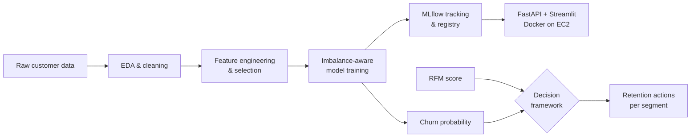
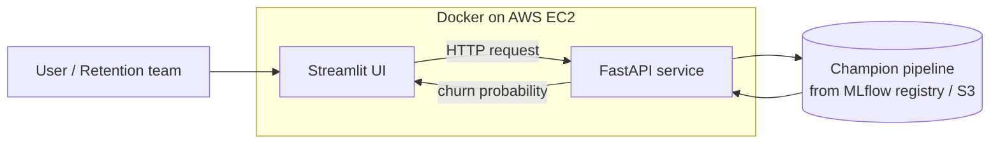

# Customer Churn Prediction & Retention Prioritisation

> An end-to-end ML system that predicts **which customers are about to churn**, ranks them by **how valuable they are (RFM)**, and tells the retention team **who to call first**. Tracked in MLflow, packaged with Docker, served via FastAPI + Streamlit on AWS EC2.

**Stack:** Python · pandas · scikit-learn · imbalanced-learn · MLflow · FastAPI · Streamlit · Docker · AWS (EC2, S3, SageMaker MLflow)

---

## 1. At a Glance

| | |
|---|---|
| **Business problem** | ~1 in 5 customers churns. Retention budget is limited, so we can't discount or call everyone. |
| **Solution** | Churn probability (ML) × customer value (RFM) → a prioritised action list |
| **Final model** | Balanced Random Forest in a single sklearn `Pipeline` (preprocessing + model) |
| **Hold-out performance** | Churn **Recall 0.94** · Precision 0.91 · F1 0.93 · ROC-AUC 0.988 · PR-AUC 0.970 |
| **What that means** | On 1,599 unseen customers (328 real churners) the model catches ≈309 of them with ≈30 false alarms. Targeting at random would be right ~20% of the time; the model is right ~91% of the time (**≈4.4× lift**) |
| **Strongest churn signal** | Newsletter non-subscribers churn at ~37% vs ~13% for subscribers |
| **Delivery** | Dockerised FastAPI (prediction API) + Streamlit (UI) on AWS EC2 |

---

## 2. Business Problem

**Goal:** reduce *avoidable* customer loss and spend the retention budget where it pays back.

Predicting churn alone isn't enough. A 95%-likely-to-churn customer who has spent $20 is not worth the same effort as one who spends $5,000 a year. So the project answers three questions:

| # | Question | How we answer it |
|---|---|---|
| 1 | Who are our customers and how do they behave? | EDA |
| 2 | Who is likely to leave? | Churn classifier |
| 3 | Of those, who is worth saving first, and with what action? | Churn probability × RFM segmentation |



---

## 3. Data

- **8,000 customers × 20 columns**, no missing values, one row per customer.
- **Target:** `churned` (1 = churned). Churn rate ≈ **20.5%** → imbalanced.

| Group | Columns |
|---|---|
| Demographics | `age`, `gender`, `country` |
| Account | `membership_tier`, `registration_date`, `acquisition_channel`, `newsletter_subscribed` |
| Purchase behaviour | `total_orders`, `total_spend_usd`, `avg_order_value_usd`, `days_since_last_purchase` |
| Preferences | `preferred_category`, `preferred_device`, `preferred_payment_method` |
| Engagement | `reviews_given`, `avg_review_score`, `returns_made`, `wishlist_items` |

---

## 4. Exploratory Data Analysis: What the Data Says

| Finding | Evidence | Why it matters to the business |
|---|---|---|
| **Newsletter subscription is the strongest churn driver** | Churn ≈ 37% (not subscribed) vs ≈ 13% (subscribed). Chi-square = 693, p ≈ 1e-152 | Cheap lever: push newsletter opt-in at sign-up and checkout |
| **Inactivity predicts churn** | Churners have noticeably higher `days_since_last_purchase` | Trigger win-back campaigns on a recency threshold, before the customer is gone |
| **Low satisfaction predicts churn** | Churners cluster at avg review score ≈ 2–2.5; retained customers at ≈ 4–4.5 | Route low-score customers to customer support |
| **Channel, device, payment method barely matter** | Churn is ≈ 18–22% across all of them | Don't over-invest in channel-specific retention tactics |
| **Returns and review *count* are weak signals** | Distributions look similar for churners and non-churners | Low priority for intervention design |
| **Spend/order features are heavily right-skewed** | A few very large customers, most are small | Motivates log transform and a careful outlier policy (below) |
| **Class imbalance** | ≈ 79.5% retained / 20.5% churned | Accuracy is a misleading metric here (see §7) |

---

## 5. Data Preparation

### 5.1 Outlier policy: business rules, not blind trimming

IQR flagged outliers in all skewed numeric columns, but statistical outliers are not necessarily errors. Each was judged against business logic:

| Column | Observation | Decision |
|---|---|---|
| `age`, `total_orders`, `total_spend_usd`, `days_since_last_purchase`, `wishlist_items` | Extreme but realistic (power users, long-inactive customers) | **Kept**: this *is* the high-value / high-risk population we care about |
| `avg_order_value_usd` | Values > $5,000 with only **1 order** are implausible under the assumed single-order limit | **Removed** (8 records, 8,000 → 7,992) |

### 5.2 Encoding & transforms (inside the sklearn pipeline)

| Transform | Applied to | Why |
|---|---|---|
| `log1p` | `total_orders`, `total_spend_usd`, `avg_order_value_usd`, `days_since_last_purchase`, `reviews_given`, `returns_made`, `wishlist_items` | Tame right skew; `log1p` is safe for zeros |
| **One-hot encoding** | `gender`, `preferred_device`, `preferred_payment_method`, `acquisition_channel` (originally also `country`, `preferred_category`) | Nominal categories with no order. `handle_unknown='ignore'` so unseen categories in production don't crash the API |
| **Ordinal encoding** | `membership_tier` → Free < Silver < Gold < Platinum | The tiers have a natural order, so one-hot would throw that information away |
| Pass-through | `age`, `avg_review_score`, `newsletter_subscribed` | Already well-scaled / binary |
| Dropped | `customer_id`, `registration_date` | Identifier / raw date, not a behavioural feature |

Train/test split: **80/20, stratified on `churned`** (6,393 train / 1,599 test) so both sets keep the 20.5% churn rate.

---

## 6. Feature Selection: What We Removed and Why

The first preprocessing produced **64 features** (country and category one-hot columns inflate the count). Several techniques were used to decide what to keep:

| Technique | Applied to | Result |
|---|---|---|
| **Chi-square test of independence** | All categorical columns vs `churned` | Only `newsletter_subscribed` is significant (p ≈ 1e-152). `membership_tier` borderline (p = 0.08). `country`, `preferred_category`, `gender`, channel, payment, device: **not significant** (p > 0.2) |
| **Chi-square on one-hot columns** | Individual dummy columns | Only one dummy (`country_Netherlands`, p ≈ 0.01) is significant; nothing in `preferred_category` is |
| **Decision-tree feature importance** | All 64 features | Most `country` dummies and `returns_made` get **zero** importance |
| **Ablation test (retrain & compare)** | Drop `country` → drop `country` + `preferred_category` | Proves the removal is safe (table below) |

### Removed features and reasons

| Removed | # cols | Reason |
|---|---|---|
| `country_*` | 20 | Not significant in chi-square; zero importance in tree; dropping it did **not** hurt CV F1 |
| `preferred_category_*` | 14 | Not significant in chi-square; dropping it did **not** hurt CV F1 |
| `customer_id`, `registration_date` | n/a | Identifier / raw date |

### Ablation results: Balanced Random Forest, 5-fold stratified CV

| Feature set | # features | CV F1 (mean ± std) | Test F1 (churn) |
|---|---|---|---|
| All features | 64 | n/a | 0.92 |
| − country | 44 | 0.893 ± 0.014 | 0.92 |
| − country − category | **30** | **0.895 ± 0.006** | **0.93** |

**Takeaway:** 34 features removed with no loss in accuracy, and the CV variance more than halved (0.014 → 0.006), so a simpler, more stable model. Fewer inputs also means a simpler API contract and less drift to monitor in production.

> `gender`, `acquisition_channel`, `preferred_device` and `preferred_payment_method` were *statistically* weak too but were kept in the final model because they cost little and caused no harm; they are candidates for the next pruning round.

---

## 7. Imbalanced Data, Model Selection & Metrics

### 7.1 How imbalance is handled

| Technique | Where |
|---|---|
| **Stratified** train/test split and CV folds | Everywhere, so each fold sees ~20% churners |
| **`class_weight='balanced'`** | Logistic Regression, Decision Tree |
| **Balanced Random Forest** (each tree trained on a balanced bootstrap sample) | Final model |
| **Metrics that ignore the majority class** | F1, recall, PR-AUC (not accuracy) |

### 7.2 Why these metrics

| Metric | Role | Reasoning |
|---|---|---|
| **Accuracy** | Reported, **not** used to choose | Predicting "nobody churns" already scores ~80% |
| **Recall (churn)** | Business-critical | A missed churner is lost revenue |
| **Precision (churn)** | Business-critical | A false alarm wastes retention budget and discounts |
| **F1 (churn)** | Primary selection metric | Balances the two |
| **PR-AUC** | Secondary | Honest ranking quality under imbalance |
| **ROC-AUC** | Secondary | Threshold-independent separation |

### 7.3 Model comparison (30-feature set, same stratified 5-fold CV and 20% hold-out)

| Metric | Logistic Regression | Decision Tree | **Balanced Random Forest** |
|---|---|---|---|
| CV F1 (mean) | 0.751 | 0.881 | **0.895** |
| CV F1 (std) | 0.017 | 0.006 | **0.006** |
| CV ROC-AUC | 0.947 | 0.965 | **0.982** |
| CV PR-AUC | 0.884 | 0.928 | **0.958** |
| Test Precision (churn) | 0.688 | 0.884 | **0.912** |
| Test Recall (churn) | 0.887 | 0.930 | **0.942** |
| Test F1 (churn) | 0.775 | 0.906 | **0.927** |
| Test ROC-AUC | 0.957 | 0.974 | **0.988** |
| Test PR-AUC | 0.887 | 0.949 | **0.970** |

**Decision:** Balanced Random Forest wins on every metric, with the lowest fold-to-fold variance.
**Why not the others?**
- *Logistic Regression* (baseline): high recall but low precision: it flags too many loyal customers, wasting budget.
- *Decision Tree*: close second, interpretable, kept as the **challenger** model. Grid search (64 candidates × 5 folds) lifted its CV F1 from 0.881 to 0.892, still short of the forest.

---

## 8. Final Pipeline

One `sklearn.pipeline.Pipeline` = preprocessing + model, so **training and serving use identical transforms** (no train/serve skew):

```
Pipeline
├── ColumnTransformer
│   ├── log1p            → 7 skewed numeric columns
│   ├── OneHotEncoder    → gender, device, payment method, acquisition channel
│   ├── OrdinalEncoder   → membership_tier (Free < Silver < Gold < Platinum)
│   └── passthrough      → age, avg_review_score, newsletter_subscribed
└── BalancedRandomForestClassifier(n_estimators=200, random_state=42)
```

Raw customer fields go in; a churn probability comes out.

---

## 9. Experiment Tracking & Model Registry (MLflow)

| What | Detail |
|---|---|
| Experiment | `Churn_prediction_experiments` |
| Logged per run | All model hyper-parameters, per-class precision / recall / F1, and the full fitted pipeline as a model artifact |
| Runs compared | Balanced Random Forest vs Decision Tree |
| Registry | Balanced Random Forest → alias **`champion`**; Decision Tree → **challenger** |
| Loading | Consumers load `models:/<name>@champion`, so promoting a new model is an alias change, not a code change |
| Cloud | Model registered in the managed MLflow tracking server on **Amazon SageMaker (ap-south-1)**; model artifact also stored in an S3 bucket |

---

## 10. RFM Analysis: Turning Predictions into Decisions

**RFM** scores every customer from 1 (worst) to 5 (best) on three dimensions, using quintiles:

| Letter | Meaning | Column | Score 5 means |
|---|---|---|---|
| **R**ecency | How recently they bought | `days_since_last_purchase` | Bought most recently |
| **F**requency | How often they buy | `total_orders` | Most orders |
| **M**onetary | How much they spend | `total_spend_usd` | Highest spend |

`RFM_score = R + F + M` (range 3–15).

### Why it matters

The model says **who might leave**. RFM says **who is worth keeping**. Combining them lets the business spend *more* on the customers who matter, and *less* (or nothing) on those who don't.

### Decision framework

| Segment | Rule (thresholds are tunable by the business) | Action |
|---|---|---|
| 🔴 **Save now** | Churn probability ≥ 0.70 **and** RFM ≥ 12 | Personal outreach (call / account manager), a strong but capped incentive |
| 🟠 **Nurture** | Churn probability ≥ 0.70 with RFM 7–11, **or** churn probability 0.30–0.69 with RFM ≥ 12 | Targeted campaign, personalised recommendations, monitor behaviour |
| ⚫ **Likely lost, low value** | Churn probability ≥ 0.90 **and** RFM ≤ 5 | Run an exit-reason investigation; retain only if economically worthwhile; otherwise automated, low-cost messaging |
| 🟢 **Healthy** | Everything else | No immediate action; keep in normal lifecycle marketing |

Scoring is done for the 1,599 hold-out customers; the output is a table of `customer_id · R · F · M · RFM_score · churn_probability`, ready to hand to CRM / marketing.

---

## 11. Deployment



| Component | Role |
|---|---|
| **FastAPI** | REST prediction endpoint: validates the input schema, loads the champion pipeline, returns churn probability |
| **Streamlit** | Business-friendly front end: enter customer details, see churn risk |
| **Docker** | Single reproducible image, same environment on a laptop and on the server |
| **AWS EC2** | Hosts the container |
| **S3 / MLflow** | Model artifact storage and versioning |

<!-- TODO: add live demo URL, FastAPI docs URL (/docs), a Streamlit screenshot, and the exact docker run command -->

---

## 12. Limitations & Next Steps

| Item | Note |
|---|---|
| **Very high scores** | ROC-AUC 0.99 is unusually strong for churn. Before production, audit features such as `days_since_last_purchase` and `avg_review_score` for leakage (are they measured *before* or *after* the customer churned?) and validate on a time-based split |
| **No cost data** | The thresholds (0.70 / 0.90) and RFM cut-offs are heuristics. With retention cost and customer lifetime value, we'd pick the threshold that maximises expected profit |
| **Tuning** | Grid search was run on the Decision Tree; the final Balanced Random Forest uses default settings with 200 trees, so tuning it is a natural next step |
| **Monitoring** | Add data-drift and performance monitoring on the deployed endpoint |
| **Next: A/B testing** | Randomised retention experiments: does contacting "Save now" customers actually reduce churn, and by how much, versus a control group? That turns *predicted* value into *measured* uplift |

---
# 🧪 A/B Test: Does a 10% Offer Reduce Customer Churn?

> **TL;DR:** ✅ Yes. The offer cut 60-day churn from **76.6% → 71.2%** (−5.4 pp, p = 0.029). It's statistically significant, but profitability is still untested.

---

## 🎯 1. Business Problem

- 📉 About **1 in 5 customers churn**, and the retention budget is limited.
- 🤖 The churn model flags **high-risk customers (score ≥ 0.70)**.
- ❓ **Question:** Does a **10% offer** to these customers reduce churn vs. doing nothing?
- 🚦 **Decision:** Roll the offer out to high-risk customers, or don't.

---

## 📏 2. Setup

| Item | Choice |
|---|---|
| 👥 Population | High-risk customers (score ≥ 0.70) |
| 🎲 Randomisation | Per customer, 50/50 coin flip |
| 🎁 Treatment | 10% offer |
| 🚫 Control | No offer (business as usual) |
| ⏱️ Outcome window | 60 days after the offer |
| 📊 Success metric | **60-day churn rate** (`churned_60d`, 1 = churned) |
| 🔍 Analysis | Intention-to-treat (analyse everyone as assigned) |
| 🛑 Stopping rule | Fixed sample, no peeking |

```
High-risk customers (score ≥ 0.70)
          │  random 50/50
    ┌─────┴─────┐
 10% offer    No offer
    │             │
60-day churn  60-day churn  →  compare
```

---

## 🧮 3. Test Parameters

| Parameter | Value | Meaning |
|---|---|---|
| H₀ | No difference in churn | The offer does nothing |
| H₁ | Churn differs | The offer changes churn |
| α (significance) | **0.05** | 5% risk of a false alarm |
| Power | **80%** | 80% chance to detect a real effect |
| MDE | **7 pp** (80% → 73%) | Smallest effect worth caring about |
| Planned sample | ~**575 per arm** | Needed for the above |
| Test used | Two-sided two-proportion z-test | |

---

## 🗂️ 4. Data Check

- 📄 **1,266 customers**, 7 columns
- ✅ No missing values
- ✅ No duplicate rows or customer IDs
- 📦 Group sizes (both above the planned 575):

| Group | Customers | Share |
|---|---:|---:|
| 🚫 Control | 637 | 50.32% |
| 🎁 Treatment | 629 | 49.68% |

---

## ⚖️ 5. Sanity Check: Sample Ratio Mismatch (SRM)

Are the group sizes close to the planned 50/50?

- Chi-square = **0.0506**, p = **0.8221**
- Rule: p < 0.001 means stop and investigate
- ✅ **PASS**: the split is fine.

---

## 📊 6. Results

| Metric | 🚫 Control | 🎁 Treatment |
|---|---:|---:|
| Customers | 637 | 629 |
| Churned | 488 | 448 |
| **Churn rate** | **76.61%** | **71.22%** |

```
Control    ████████████████████████████████████████  76.6%
Treatment  █████████████████████████████████████     71.2%
```

| Stat | Value |
|---|---|
| Absolute difference | **−5.38 pp** |
| Relative reduction | **~7.0%** |
| z-statistic | −2.182 |
| p-value | **0.0291** |
| 95% CI (difference) | **[−10.19, −0.55] pp** |

✅ p < 0.05, so we **reject H₀**.
✅ The CI doesn't include 0, so the effect is real at the 5% level.

---

## ✅ 7. Conclusion

- 🎉 The 10% offer **significantly reduced 60-day churn**.
- 📉 About **5 fewer customers churn per 100 offers**.

### ⚠️ Caveats

- 🎯 The observed drop (5.4 pp) is **smaller than the 7 pp MDE** we planned for.
- 📏 The CI is **wide**: the true effect could be anywhere from ~0.5 pp to ~10 pp.
- 💰 **Cost not yet considered.** A 5 pp drop may or may not pay for the discount.
- 🧪 The planned **balance / selection-bias check (SMD < 0.10)** is not run in the notebook yet.
- 🧬 The dataset is **simulated**.

---

## 🚀 8. Next Steps

1. 🧪 Run the **SMD balance check** on `model_score`, `avg_review_score`, `rfm_score`, `enroll_week`.
2. 💵 Add **money metrics**: margin, cost per saved customer, ROI.
3. 🔬 Check **sub-segments** (e.g. by RFM score) to see who responds most.
4. 🚦 Make the rollout call once the economics are clear.

---

## 🛠️ Tools Used

`Python` · `pandas` · `numpy` · `scipy` · `statsmodels` · `seaborn` · `matplotlib`
